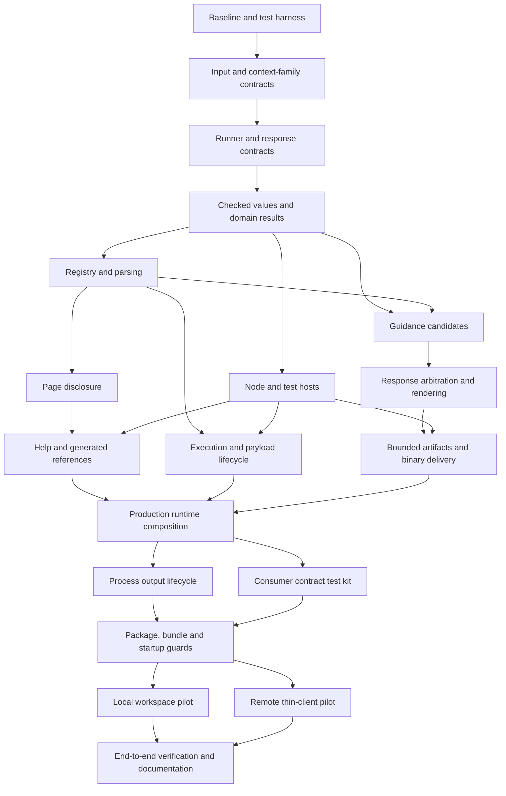

# Implementation graph

Saved in CC as **Implement cli-for-agents: first usable library**, revision 2,
workflow ID `e88c16c2-f83e-46de-bd07-de9ba6070ac6`. The revised definition addresses
the external review's nine findings and passes structural validation without
warnings. The earlier approval does not carry over; this revision is ready for
fresh review. It has not started.

The planning draft delivers the first usable library through 19 execution
contexts, 50 tasks and 26 dependency edges. It starts by revising the public
contract in response to review, implements the private runtime owners in parallel,
and proves the composed package through real executable local and remote pilots.

The full decisions and acceptance matrix are in
[the implementation contract](implementation-workflow.md). The machine-readable
definition is `.cc/temp/plan.json`; the visual builder shows the saved graph.
This planning work does not begin runtime implementation or launch execution.

Each context has observable acceptance criteria, an explicit production caller,
named test files and bounded evidence output. The two contract contexts retain
stubs and use compiler controls. Runtime tasks use red-green-refactor through
the registered command scoped to an exact test file. Same-lane contexts are
dependency ordered; independent owners use separate lanes and join before public
runtime composition.

The review repairs include real registry declarations before guidance tests,
application lifetime through guidance and artifact-policy resolution, honest
unknown-acknowledgment recovery, and byte-budget proofs for JSON and text output.
The final context owns failures introduced by this graph within its named matrix.

## Before launch

The current canonical CC validation registry is empty and the scaffold is
uncommitted. A lane fork cannot receive that uncommitted source. The saved draft
therefore has no selected automatic script commands yet and must not be launched
in that state.

1. Use CC's normal source/config promotion flow to make the scaffold and planning
   documents available to lanes. The proposed files under
   `.cc/temp/workflow-plan/validation-bootstrap/` supply the exact-file test
   launcher and canonical registration proposal; they are preparation assets.
2. Confirm `cctl validate list` exposes `typecheck`, `build` and `test`. The test
   profile compiles first, accepts exact `.test.mjs` files, pins concurrency to
   one worker and declares cost 2. The baseline context introduces the first
   runtime harness file.
3. Provision the Node 20 floor at
   `/Users/alex/.local/share/cli-for-agents/runtimes/node20/bin/node`, which is
   currently absent. From the lane agent shell, execute that absolute path with
   `--version` and require major 20. Also execute
   `/Users/alex/.nvm/versions/node/v24.16.0/bin/node --version` and
   `/Users/alex/.bun/bin/bun --version` (verified v24.16.0 and 1.3.14). These
   invocations do not rely on sourcing nvm. The first context repeats these
   checks and records the paths/versions before implementation proceeds.
4. Read the saved definition revision with `cctl workflow get <workflow-id>`
   using the ID above.
   Set that revision in `.cc/temp/workflow-plan/gate-binding.json`, then apply
   the operations with `cctl workflow edit <workflow-id> --file
   .cc/temp/workflow-plan/gate-binding.json`. This binds typecheck/build to the
   contract contexts and adds runtime tests at the other boundaries.
5. Validate and review the resulting definition before separately launching it.
   Editing gates creates a new revision; the draft's review does not carry over.

The gate-binding dry run currently refuses only the expected missing validation
registrations; no changes were applied. The proposed launcher passed Bash/Node
syntax checks and 13 isolated diagnostics covering exact scope, failure output,
invalid paths and empty inventories. These checks do not establish runtime-library
behavior or launch readiness.

[The review response](workflow-review-response-2026-09-14.md) maps the nine findings
and advisory repairs to their new owners and explains the remaining prerequisites.

No consumer migration, package publication, optional transport/job kits, live
progress, raw stdout escape hatch or streaming export is included. The two pilots
are maintained in this repository and use real temporary files and loopback
transport; they do not modify cctl or kb.
